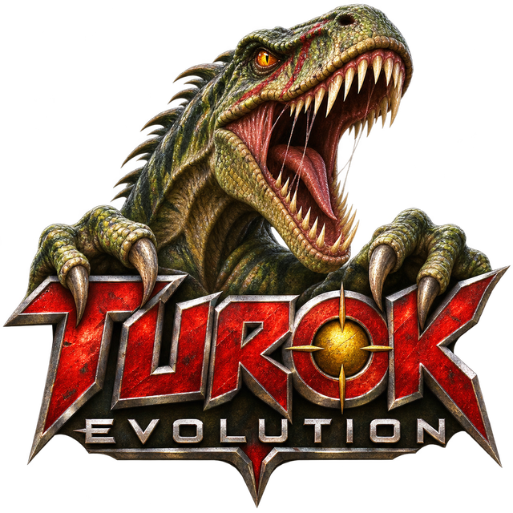

<p align="center">
  
</p>

<h1 align="center">Turok Evolution Recomp</h1>

<p align="center"><a href="README.pt-BR.md">Português (Brasil)</a></p>

Turok: Evolution for the original Xbox, **USA (NTSC) release**, recompiled into a
native PC program. You bring your own copy of the game: the installer builds it
from your disc on your computer. This repository and its releases contain no
game code or data.

- [Play](#play): install from your disc, then play.
- [Build it yourself](#build-it-yourself): for developers working on the port.

# Play

## Status

Work in progress. On Windows the intro movies, the menus and the game run.
A full playthrough has not been tested yet. Linux and macOS builds come with
the toolkit but have not been tried with this port.

## What you need

- Turok: Evolution, USA (NTSC) release, as a disc image (`.iso` or `.xiso`).
  Other releases are refused (see [Releases of the game](#releases-of-the-game)).
- 64-bit Windows 10 or 11.
- About 3 GB free in the folder you install to (the game's data is copied
  there).

Nothing else needs installing: the installer carries everything it builds the
game with.

## Install

1. Start `turok.exe` from the installer.
2. Choose the installation folder with **CHOOSE FOLDER...** (an empty one), and
   your disc image with **SELECT ISO...**.
3. Press **INSTALL**. The disc is checked, extracted and the game compiled,
   with a progress bar and a live log. This takes a few minutes.
4. When it finishes, a **Turok Evolution Recomp** shortcut is on your desktop.

The installation folder holds everything: the game (`turok_recomp.exe`), the
launcher (`turok.exe`), the disc's data (`game/`) and your settings and saves
(`user/`). Copy the whole folder to move the game to another place or PC; the
disc image, the installer and the repository are not needed to play. Keep
`.turok-portable` in it, so settings and saves move with it.

**Windows** may say it protected your PC, because the installer is not signed:
choose More info, then Run anyway.

Choose **English** or **PT-BR** with the flags at the top of the installer and
the launcher.

## Controls

Controllers work as an Xbox pad. The keyboard plays as controller 1:

| Xbox | Key |
| --- | --- |
| D-pad | Arrows |
| A, B, X, Y | Z, X, A, S |
| Start, Back | Enter, Backspace |
| White, Black | Q, W |
| Left, right trigger | E, R |

Change them in the launcher's **Input** tab. Its mouse look option turns the
mouse into the right stick.

While playing:

| Key | |
| --- | --- |
| Back on the main menu | Close the game |
| Alt+Enter | Switch between fullscreen and a window |
| Alt+F4 | Close the game |
| F9 | Show or hide the frame rate |
| F10 | Change the frame cap |
| F11 | Save a screenshot and a capture of the frame, for bug reports |

## Settings

In the launcher's **Video** tab:

| Setting | What it does |
| --- | --- |
| Graphics card | Which GPU runs the game. Automatic prefers the dedicated one |
| Resolution | Renders at 1 to 8 times 640x480 and filters down. 2 is much sharper and costs little |
| Widescreen | 16:9, with a wider camera (the menus and movies stay 4:3) |
| Texture sharpness | Anisotropic filtering, 1 to 16 |
| Frame rate | Adaptive (60, as on the console), 30, 60, 90, 120, 144, 165, 240 or uncapped. The game keeps time by the clock, so it plays at the right speed at any of them |
| Show frame rate | Start with the counter on |
| Fullscreen | Borderless fullscreen |
| Variable refresh rate | In fullscreen, frames reach the display as soon as they are ready (G-SYNC, FreeSync) |
| Frame interpolation | Draws frames between the game's own |

## Cheats

The launcher's **Cheats** tab switches on the game's own cheats, the same ones
its Cheats menu takes as words: **Invincible**, **Unlimited ammo**, **All
weapons**, **Invisible** and **Level select**. A cheat left off still works
from the game's menu with its word.

## Updating

Start the new installer and choose the same folder. It sees that the game was
built by an older release and builds it again; settings and saves are kept.

## Problems

- The disc is refused: it is not the release below. Please open an issue with
  the SHA-1 the message shows.
- The installation fails: open an issue and attach `build.log` from the
  installation folder.
- A black window and nothing else: attach `turok_recomp.log` from the same
  folder.
- A rendering bug in one place: press F11 there, and attach the `.bmp` and
  `.d3dcap` files it writes beside the game.

## Releases of the game

The game is recognised by the SHA-1 of its `default.xbe`:

| Release | `default.xbe` SHA-1 |
| --- | --- |
| USA (NTSC) | `25e1d77b216a2e557d7a5de6266cda64ae62627b` |

For the European (PAL) release, use
[phobos665/turok-evolution-recomp](https://github.com/phobos665/turok-evolution-recomp).

# Build it yourself

For working on the port. The build translates the game's code to C with the
toolkit in `xboxrecomp/` (based on
[DirectXbox-Recomp](https://github.com/phobos665/DirectXbox-Recomp)), then
compiles it.

## What you need to build

- The USA disc, extracted (`default.xbe` and the rest of its files).
- Windows 10 or 11, 64-bit, with Visual Studio 2022 (Desktop development with
  C++), CMake 3.20 or newer and Git.
- Python 3.10 or newer with `capstone`: `py -3 -m pip install capstone`.

## Build

```sh
git clone --recursive https://github.com/danfreitas97/turok-evolution-recomp.git
cd turok-evolution-recomp
py -3 scripts/build.py --game "C:/path/to/the/extracted/disc"
```

`scripts/env.ps1` puts Visual Studio's compiler and CMake on the path of a
PowerShell window, if they are not there already. The first run translates the
game, which takes a few minutes, then compiles it. Later runs only recompile.
The game (`turok_recomp.exe`) and the launcher (`turok_recomp_launcher.exe`)
end up in `build/Release/`. Set `RECOMP_GAME_DIR` to the extracted disc when
you run them from there.

If you cloned without `--recursive`, run `git submodule update --init --recursive`.

## Settings file

Every launcher setting is also a line in the settings file (`user/` in an
installation) and an environment variable, which wins over the file:

| Setting | File | Environment |
| --- | --- | --- |
| Resolution | `resolution_scale` | `RECOMP_RES_SCALE` |
| Widescreen | `widescreen` | `RECOMP_WIDESCREEN` |
| Texture sharpness | `anisotropy` | `RECOMP_ANISO` |
| Frame rate | `frame_cap` (0 for uncapped) | `RECOMP_FPS_CAP` |
| Show frame rate | `fps_overlay` | `RECOMP_FPS_OVERLAY` |
| Fullscreen | `fullscreen` | `RECOMP_FULLSCREEN` |
| Variable refresh rate | `vrr` | `RECOMP_VRR` |
| Cheats | `cheat_invincible`, `cheat_unlimited_ammo`, `cheat_all_weapons`, `cheat_invisible`, `cheat_level_select` | `TUROK_CHEAT_INVINCIBLE`, ... |

The controls' format is in `xboxrecomp/docs/technical/input-binding.md`.

## Updating a clone

```sh
git pull
git submodule update --init --recursive
py -3 scripts/build.py --game "C:/path/to/the/extracted/disc" --relift
```

`--relift` translates the game again, which is needed whenever the toolkit,
`config/` or `src/recomp_manual.c` changes. `--relift --from lift` repeats only
the last stage, which is enough after a change to `src/recomp_manual.c`.

`config/` and `src/recomp_manual.c` hold addresses inside the USA
`default.xbe`; another release would need its own.

## Making a release

Pushing a version tag (`git tag v1.0 && git push origin v1.0`) runs
`.github/workflows/release.yml`, which builds the installer from
`release/turok.json` and attaches it to the tag's GitHub release. No game
files are involved. How the installer works is in
[xboxrecomp/docs/technical/self-build-release.md](xboxrecomp/docs/technical/self-build-release.md).

# Credits

- [phobos665/turok-evolution-recomp](https://github.com/phobos665/turok-evolution-recomp)
  (GPL-3.0): the PAL port this repository is based on.
- [phobos665/DirectXbox-Recomp](https://github.com/phobos665/DirectXbox-Recomp)
  (GPL-3.0): the toolkit, `xboxrecomp/` here.
- [sp00nznet/xboxrecomp](https://github.com/sp00nznet/xboxrecomp) (MIT): the
  original toolkit DirectXbox-Recomp is forked from.

# Legal

You need your own copy of Turok: Evolution. Do not share the game's files, the
built game, a clone's `src/recomp/` (it is the game's translated code) or
anything in `build/`. This repository, its releases and the toolkit contain no
game code or assets.

The code in this repository is licensed under the GNU General Public License
v3.0; see [LICENSE](LICENSE). That covers the files committed here, not the game.
