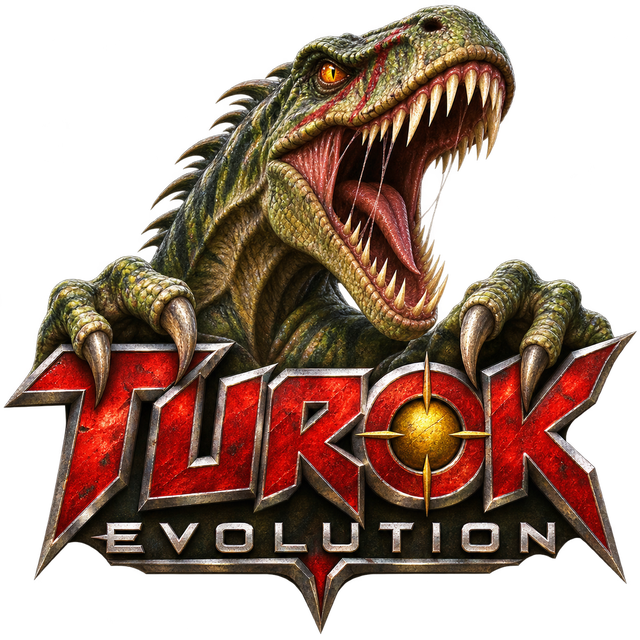

<p align="center">
  
</p>

<h1 align="center">Turok Evolution Recomp</h1>

<p align="center"><a href="README.md">English</a></p>

Turok: Evolution do Xbox original, **versão USA (NTSC)**, recompilado como um
programa nativo de PC. Você usa a sua própria cópia do jogo: o instalador
compila o jogo a partir do seu disco, no seu computador. Este repositório e os
releases não contêm código nem dados do jogo.

- [Jogar](#jogar): instale a partir do seu disco e jogue.
- [Compilar você mesmo](#compilar-você-mesmo): para quem trabalha no port.

# Jogar

## Situação

Em andamento. No Windows, os vídeos de abertura, os menus e o jogo rodam.
Uma partida completa ainda não foi testada. Os builds para Linux e macOS
existem no toolkit, mas não foram testados com este port.

## O que você precisa

- Turok: Evolution, versão USA (NTSC), como imagem de disco (`.iso` ou
  `.xiso`). Outras versões são recusadas (veja [Versões do jogo](#versões-do-jogo)).
- Windows 10 ou 11 de 64 bits.
- Cerca de 3 GB livres na pasta de instalação (os dados do jogo são copiados
  para lá).

Não é preciso instalar mais nada: o instalador traz tudo que é usado para
compilar o jogo.

## Instalar

1. Abra o `turok.exe` do instalador.
2. Escolha a pasta de instalação em **ESCOLHER PASTA...** (uma pasta vazia) e a
   sua imagem de disco em **SELECIONAR ISO...**.
3. Clique em **INSTALAR**. O disco é conferido e extraído, e o jogo é
   compilado, com barra de progresso e log ao vivo. Leva alguns minutos.
4. No fim, aparece um atalho **Turok Evolution Recomp** na sua área de
   trabalho.

A pasta de instalação guarda tudo: o jogo (`turok_recomp.exe`), o launcher
(`turok.exe`), os dados do disco (`game/`) e as suas configurações e saves
(`user/`). Para levar o jogo para outro lugar ou outro PC, copie a pasta
inteira; a imagem do disco, o instalador e o repositório não são necessários
para jogar. Mantenha o `.turok-portable` dentro dela, para que configurações e
saves acompanhem a pasta.

O **Windows** pode dizer que protegeu o seu PC, porque o instalador não é
assinado: clique em Mais informações e depois em Executar assim mesmo.

Escolha **English** ou **PT-BR** pelas bandeiras no topo do instalador e do
launcher.

## Controles

Os controles funcionam como um controle de Xbox. O teclado joga como o
controle 1:

| Xbox | Tecla |
| --- | --- |
| Direcional | Setas |
| A, B, X, Y | Z, X, A, S |
| Start, Back | Enter, Backspace |
| White, Black | Q, W |
| Gatilho esquerdo, direito | E, R |

Mude-os na aba **Controles** do launcher. A opção de câmera com o mouse
transforma o mouse no analógico direito.

Durante o jogo:

| Tecla | |
| --- | --- |
| Back no menu principal | Fecha o jogo |
| Alt+Enter | Alterna entre tela cheia e janela |
| Alt+F4 | Fecha o jogo |
| F9 | Mostra ou esconde a taxa de quadros |
| F10 | Muda o limite de quadros |
| F11 | Salva uma captura de tela e uma captura do quadro, para relatar bugs |

## Configurações

Na aba **Vídeo** do launcher:

| Opção | O que faz |
| --- | --- |
| Placa de vídeo | Qual GPU roda o jogo. Automático prefere a dedicada |
| Resolução | Renderiza de 1 a 8 vezes 640x480 e reduz. 2 já fica bem mais nítido e custa pouco |
| Tela ampla | 16:9, com a câmera mais aberta (menus e vídeos continuam em 4:3) |
| Nitidez das texturas | Filtragem anisotrópica, de 1 a 16 |
| Taxa de quadros | Adaptável (60, como no console), 30, 60, 90, 120, 144, 165, 240 ou sem limite. O jogo marca o tempo pelo relógio, então roda na velocidade certa em qualquer uma |
| Mostrar FPS | Começa com o contador ligado |
| Tela cheia | Tela cheia sem bordas |
| Taxa de atualização variável | Em tela cheia, os quadros vão para a tela assim que ficam prontos (G-SYNC, FreeSync) |
| Interpolação de quadros | Desenha quadros entre os do próprio jogo |

## Cheats

O jogo tem um menu Cheats, onde cada cheat é liberado digitando a palavra dele
e depois ligado ou desligado. A aba **Cheats** do launcher libera os cheats sem
as palavras: **Invencível**, **Munição infinita**, **Todas as armas**,
**Invisível** e **Seleção de fase**. Ela não liga os cheats: ligue e desligue
no menu Cheats do jogo, durante a partida. A seleção de fase, depois de
liberada, permite começar qualquer fase pelo menu.

Uma mudança no launcher vale a partir da próxima vez que o jogo abrir. Um cheat
desligado ali ainda pode ser liberado no jogo com a palavra dele.

## Atualizar

Abra o instalador novo e escolha a mesma pasta. Ele percebe que o jogo foi
compilado por um release antigo e compila de novo; configurações e saves são
mantidos.

## Problemas

- O disco é recusado: não é a versão listada abaixo. Abra uma issue com o
  SHA-1 que a mensagem mostra.
- A instalação falha: abra uma issue e anexe o `build.log` da pasta de
  instalação.
- Só uma janela preta: anexe o `turok_recomp.log` da mesma pasta.
- Um erro de imagem num lugar específico: aperte F11 ali. Ele grava ao lado do
  jogo uma imagem do quadro (`frame000.bmp`, depois `frame001.bmp`, ...) e
  uma captura dele (`frame000.d3dcap`, ...). Anexe a imagem, num
  `.zip` ou salva como PNG (o GitHub não aceita `.bmp`), e o
  `turok_recomp.log`. Não publique o `.d3dcap`, a não ser que alguém que
  trabalha no port peça: ele guarda as texturas do quadro, que são do jogo.

## Versões do jogo

O jogo é reconhecido pelo SHA-1 do seu `default.xbe`:

| Versão | SHA-1 do `default.xbe` |
| --- | --- |
| USA (NTSC) | `25e1d77b216a2e557d7a5de6266cda64ae62627b` |

Para a versão europeia (PAL), use o
[phobos665/turok-evolution-recomp](https://github.com/phobos665/turok-evolution-recomp).

# Compilar você mesmo

Para quem trabalha no port. A compilação traduz o código do jogo para C com o
toolkit em `xboxrecomp/` (baseado no
[DirectXbox-Recomp](https://github.com/phobos665/DirectXbox-Recomp)) e depois
o compila.

## O que você precisa para compilar

- O disco USA extraído (`default.xbe` e o resto dos arquivos).
- Windows 10 ou 11 de 64 bits, com Visual Studio 2022 (Desenvolvimento para
  desktop com C++), CMake 3.20 ou mais novo e Git.
- Python 3.10 ou mais novo com `capstone`: `py -3 -m pip install capstone`.

## Compilar

```sh
git clone --recursive https://github.com/danfreitas97/turok-evolution-recomp.git
cd turok-evolution-recomp
py -3 scripts/build.py --game "C:/caminho/do/disco/extraido"
```

O `scripts/env.ps1` coloca o compilador do Visual Studio e o CMake no PATH de
uma janela do PowerShell, se ainda não estiverem. A primeira execução traduz o
jogo, o que leva alguns minutos, e depois compila. As próximas só recompilam.
O jogo (`turok_recomp.exe`) e o launcher (`turok_recomp_launcher.exe`) ficam em
`build/Release/`. Defina `RECOMP_GAME_DIR` com o disco extraído ao rodá-los
de lá.

Se você clonou sem `--recursive`, rode `git submodule update --init --recursive`.

## Arquivo de configurações

Toda opção do launcher é também uma linha no arquivo de configurações (em
`user/` numa instalação) e uma variável de ambiente, que tem prioridade sobre o
arquivo:

| Opção | Arquivo | Variável de ambiente |
| --- | --- | --- |
| Resolução | `resolution_scale` | `RECOMP_RES_SCALE` |
| Tela ampla | `widescreen` | `RECOMP_WIDESCREEN` |
| Nitidez das texturas | `anisotropy` | `RECOMP_ANISO` |
| Taxa de quadros | `frame_cap` (0 para sem limite) | `RECOMP_FPS_CAP` |
| Mostrar FPS | `fps_overlay` | `RECOMP_FPS_OVERLAY` |
| Tela cheia | `fullscreen` | `RECOMP_FULLSCREEN` |
| Taxa de atualização variável | `vrr` | `RECOMP_VRR` |
| Cheats | `cheat_invincible`, `cheat_unlimited_ammo`, `cheat_all_weapons`, `cheat_invisible`, `cheat_level_select` | `TUROK_CHEAT_INVINCIBLE`, ... |

O formato dos controles está em `xboxrecomp/docs/technical/input-binding.md`.

## Atualizar um clone

```sh
git pull
git submodule update --init --recursive
py -3 scripts/build.py --game "C:/caminho/do/disco/extraido" --relift
```

`--relift` traduz o jogo de novo, o que é necessário sempre que o toolkit,
`config/` ou `src/recomp_manual.c` mudam. `--relift --from lift` repete só a
última etapa, o que basta depois de uma mudança em `src/recomp_manual.c`.

`config/` e `src/recomp_manual.c` guardam endereços de dentro do
`default.xbe` USA; outra versão precisaria dos seus próprios.

## Fazer um release

Antes, coloque a seção da versão no `CHANGELOG.md` e no `CHANGELOG.pt-BR.md`
(`## 1.0.1` e uma lista): ela vira as notas do release, e o launcher a mostra
no card NOVIDADES. Depois, enviar uma tag de versão
(`git tag v1.0.1 && git push origin v1.0.1`) roda o
`.github/workflows/release.yml`, que monta o instalador a partir de
`release/turok.json` e o anexa ao release da tag no GitHub. Nenhum arquivo do
jogo é envolvido. Como o instalador funciona está em
[xboxrecomp/docs/technical/self-build-release.md](xboxrecomp/docs/technical/self-build-release.md).

# Créditos

- [phobos665/turok-evolution-recomp](https://github.com/phobos665/turok-evolution-recomp)
  (GPL-3.0): o port PAL em que este repositório se baseia.
- [phobos665/DirectXbox-Recomp](https://github.com/phobos665/DirectXbox-Recomp)
  (GPL-3.0): o toolkit, `xboxrecomp/` aqui.
- [sp00nznet/xboxrecomp](https://github.com/sp00nznet/xboxrecomp) (MIT): o
  toolkit original do qual o DirectXbox-Recomp é um fork.

# Aviso legal

Você precisa da sua própria cópia de Turok: Evolution. Não compartilhe os
arquivos do jogo, o jogo compilado, o `src/recomp/` de um clone (é o código
traduzido do jogo) nem nada em `build/`. Este repositório, os releases e o
toolkit não contêm código nem arquivos do jogo.

O código deste repositório é licenciado sob a GNU General Public License v3.0;
veja [LICENSE](LICENSE). Isso cobre os arquivos versionados aqui, não o jogo.
